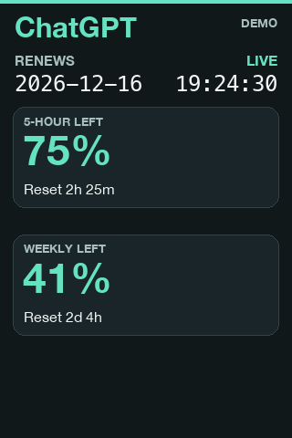
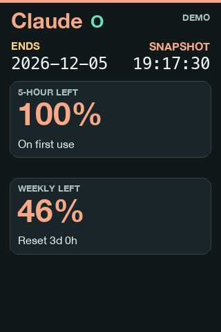

# TURZX 3.5 吋用量面板

用 Mac 把 ChatGPT 的 Work／Codex 用量送到 TURZX 3.5 吋 USB 小螢幕，也能接上 Claude Code 額度。畫面使用直向 320 × 480 解析度。



## 畫面顯示

- **剩餘額度**依帳號實際回傳的週期顯示，例如 5 小時與每週剩餘百分比，以及距離重設的時間。
- **最近 7 天 token 用量**顯示每日長條與總計。圖表按 UTC 日期排列，包含今天。
- **最後同步時間**以 Mac 的本地時間顯示。預設每 30 秒向 Codex App Server 查詢一次，最新用量以服務端回傳為準。重設倒數在本機更新。
- **LIVE** 表示兩項資料都已取得。**PARTIAL** 表示其中一項查詢失敗。**STALE** 顯示先前取得的資料，**OFFLINE** 表示兩項資料都還未取得。

額度來自 Work／Codex 共用用量，token 圖使用 App Server 的帳號統計。一般 Chat 的模型訊息上限和 OpenAI API 帳單有各自的用量來源。程式使用 Codex 既有的 ChatGPT 登入，只查詢用量，不會發送模型請求，也不會把用量存進檔案或 GitHub。

## 安裝與試跑

需要 macOS、Python 3.11 以上、libusb、支援用量查詢的 Codex CLI，以及已透過 ChatGPT 帳號登入的 Codex。程式會先找 PATH 上的 `codex`，再找 `/Applications/ChatGPT.app` 內建的 CLI。

1. 把 TURZX 3.5 吋螢幕接到 Mac 的 USB 資料埠。已實測的裝置是 Turing `UsbMonitor`、VID/PID `1a86:5722`、序號 `USB35INCHIPSV2`。
2. 下載程式並建立 Python 環境。

   ```sh
   brew install libusb
   git clone https://github.com/pcpcchen-coder/35inchSmartScreen.git
   cd 35inchSmartScreen
   python3 -m venv .venv
   .venv/bin/python -m pip install -r requirements.txt
   ```

3. 查詢一次並送到螢幕。確認硬體畫面後，移除 `--once` 就會持續刷新。

   ```sh
   .venv/bin/python dashboard.py --once
   .venv/bin/python dashboard.py
   ```

可以用 `--interval 60` 調整查詢間隔，或以 `--port /dev/cu.usbmodem…` 依 USB 位置指定裝置。畫面透過 USB bulk 直接傳輸。拔掉螢幕後，背景程式會在 USB 裝置重新出現時重連。

只想預覽版面時，用以下指令產生範例 PNG。這個模式不會查詢帳號或使用 USB。

```sh
.venv/bin/python dashboard.py --preview preview.png
```

## 登入後自動啟動

結束前景測試後，執行下列指令。服務會立即啟動，之後在同一位 macOS 使用者登入時自動啟動。

```sh
.venv/bin/python service.py install
.venv/bin/python service.py status
tail -n 30 ~/Library/Logs/35inchSmartScreen/dashboard.log
```

要停止服務並取消自動啟動，執行 `.venv/bin/python service.py uninstall`。程式資料夾移動後，請從新位置重新執行安裝。

## 從 macOS 選單列開關面板

在已建好 Python 環境的專案目錄執行下列指令。建置選單列工具需要 Xcode 或其命令列工具。

```sh
.venv/bin/python install_menu.py install
```

安裝後點選右上角的 **SmartScreen 小螢幕圖示**。工具會在登入時開啟，即使面板目前停止，仍可從圖示重新啟動。

- **啟動面板**會立刻開始並設定登入自動啟動。**停止面板**會結束更新並取消面板的登入自動啟動。
- **立即同步 ChatGPT**會要求背景服務重新查詢。Claude 資料仍由 Claude Code 狀態列提供。
- **顯示內容**可選 ChatGPT、Claude 或兩者輪播。只選 Claude 時，尚未接到資料會顯示等待畫面。
- **同步間隔、輪播間隔與螢幕亮度**可直接調整。勾選 **停止面板時熄屏** 可在正常停止時關閉小螢幕。
- **結束選單列工具**可暫時收起圖示。要再開啟，可從 Finder 開啟 `~/Applications/SmartScreen.app`。

要解除選單列工具的安裝，執行 `.venv/bin/python install_menu.py uninstall`。面板本身請用 `service.py` 管理。

## 加上 Claude 用量



Claude 頁面顯示 5 小時與每週額度。使用輪播模式時，收到第一筆 Claude 資料後，預設每 20 秒切換頁面，間隔可在選單列調整。

### 使用 Claude 桌面 App

在 Claude App 打開 **設定 → 使用量**，再從 SmartScreen 選單列選 **匯入 Claude App 用量…**。填入畫面顯示的「已使用」百分比，重設時間可留白。若目前工作階段顯示「從您的第一則訊息開始」，填 0% 並留白重設時間即可。

小螢幕會把這筆資料標為 **SNAPSHOT** 並顯示匯入時間。下次要更新時，再從 Claude App 匯入最新數字。

### 隨 Claude Code 回覆更新

可使用 Claude Code 終端版的官方狀態列更新額度。請先安裝 Claude Code，並用 Claude 訂閱帳號登入。

1. 終端機進入這個 repo，執行以下指令產生 `statusLine` 設定內容。

   ```sh
   .venv/bin/python -c 'import json, shlex, sys; from pathlib import Path; print(json.dumps({"statusLine": {"type": "command", "command": shlex.join([sys.executable, str(Path("claude_usage.py").resolve())])}}, indent=2))'
   ```

2. 把產生的 `statusLine` 欄位合併到 `~/.claude/settings.json`。如果原本已有自訂狀態列，可在原本的腳本中把同一份 stdin JSON 也傳給產生的指令，並把這段指令的 stdout 導向 `/dev/null`，以保留原本的終端機輸出。
3. 開啟 Claude Code，等平常使用時收到第一個助理回覆。不必重啟小螢幕服務。

Claude 頁面會顯示最後收到資料的時間。超過 15 分鐘沒收到資料會標示 **CACHED**。額度週期已到期時會顯示 **UPDATE DUE**，等新的回覆提供額度。只使用 Claude 網頁或桌面聊天時，面板要等下次 Claude Code 回覆才會更新。

介接腳本只把時間、用量百分比和重設時間寫到本機的 `~/Library/Caches/35inchSmartScreen/claude-usage.json`。移除狀態列設定並刪除該檔案，即可取消 Claude 輪播。

```sh
.venv/bin/python dashboard.py --preview-claude claude-preview.png
```

## 小螢幕更新方式

TURZX 透過 USB 接收點陣圖，macOS 會把它辨識為 USB 裝置。面板平常只傳送有變化的小區塊，例如剩餘額度、倒數或最後同步時間。切換 ChatGPT 和 Claude 頁面時，變動範圍較大，仍可能看見重繪。第一次開啟或重新連線時會送完整畫面。

## 畫面出現橫線或亂碼

從舊版升級時，更新 Python 相依套件，然後重新啟動背景服務。若仍有殘留亂碼，拔掉這台小螢幕的 USB 再插回，讓螢幕重新初始化。

```sh
brew install libusb
git pull --ff-only
.venv/bin/python -m pip install -r requirements.txt
.venv/bin/python service.py install
```

## 參考資料

- [Codex App Server 用量與額度介面](https://learn.chatgpt.com/docs/app-server#6-rate-limits-chatgpt)
- [OpenAI Work／Codex 用量說明](https://help.openai.com/en/articles/20001516-managing-usage-with-gpt-6-astra-in-work-and-codex)
- [Turing Smart Screen 3.5 吋硬體識別](https://github.com/mathoudebine/turing-smart-screen-python/wiki/Hardware-revisions#turing-smart-screen-35)
- [TURZX Rev. A 序列埠協定參考](https://github.com/mathoudebine/turing-smart-screen-python/blob/main/library/lcd/lcd_comm_rev_a.py)
- [macOS 花屏與 USB bulk 傳輸驗證](https://github.com/mathoudebine/turing-smart-screen-python/issues/7)
- [Claude Code 狀態列的訂閱用量欄位](https://code.claude.com/docs/en/statusline#rate-limit-usage)
